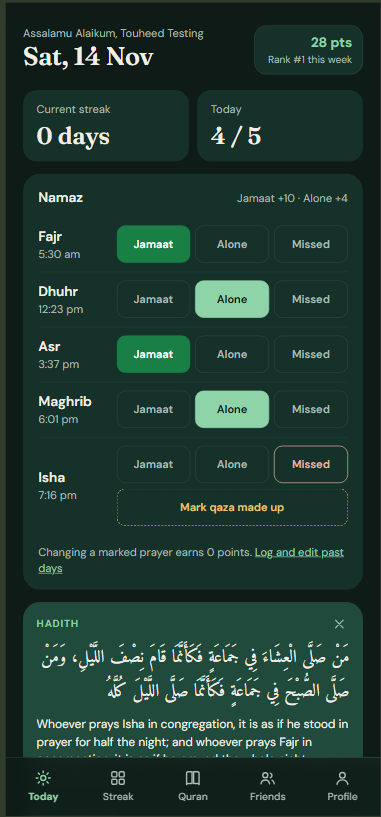
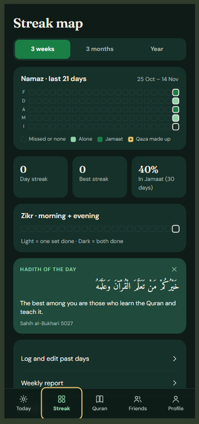
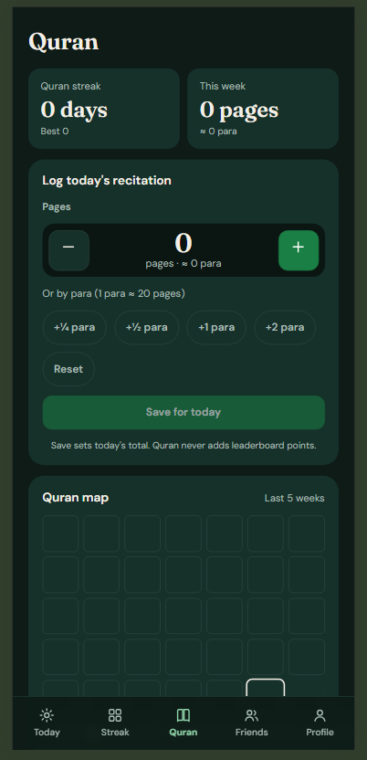
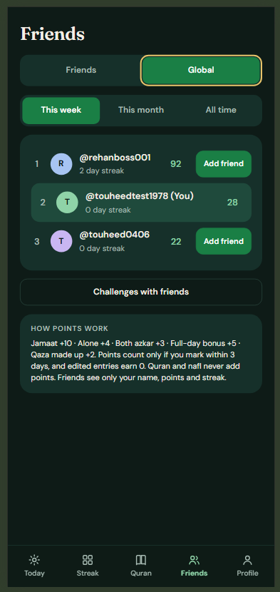
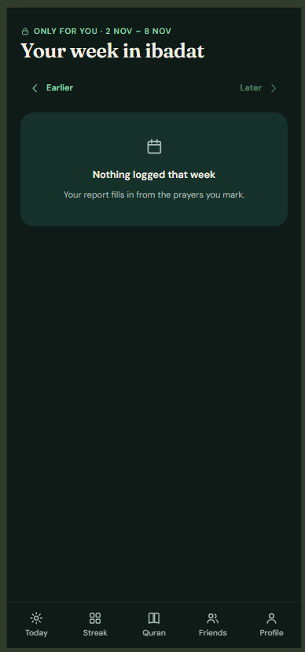
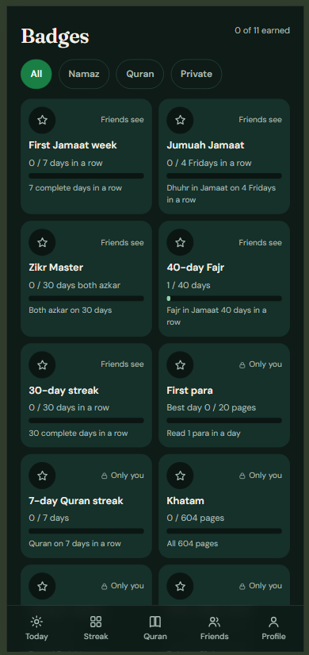
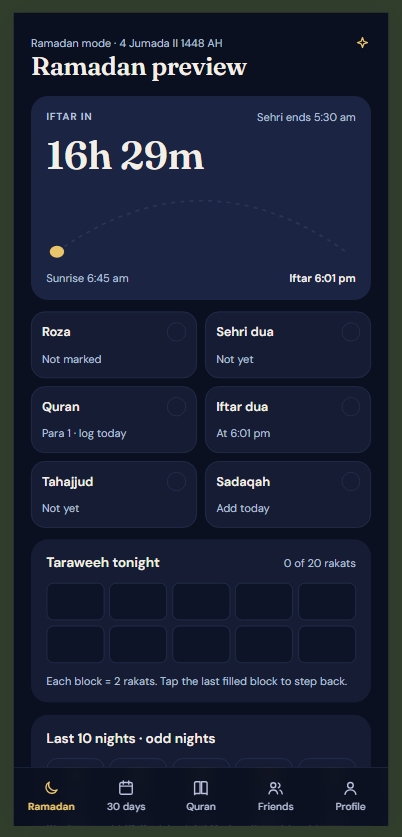
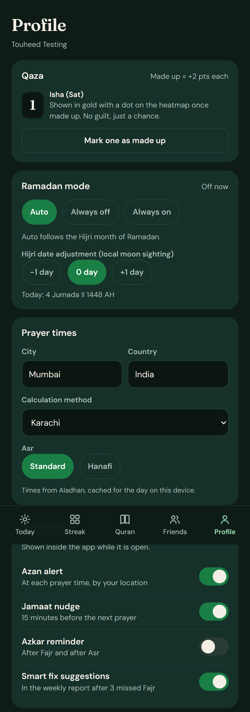
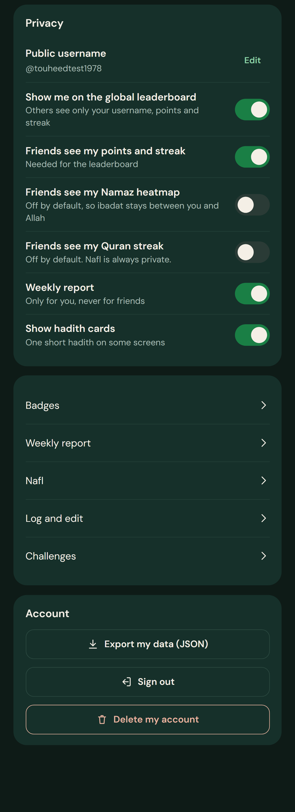

<p align="center"></p>

<p align="center">
  <a href="https://github.com/touheed-dev/zikr-namaz-tracker/actions/workflows/ci.yml">
    
  </a>
  <a href="https://zikr-namaz-tracker.vercel.app">
    
  </a>
  
  
  
  
  
</p>

<p align="center">
  <a href="https://zikr-namaz-tracker.vercel.app">Live app</a> ·
  <a href="#whats-new">What's new</a> ·
  <a href="#features">Features</a> ·
  <a href="#known-issues">Known issues</a> ·
  <a href="#run-locally">Run locally</a> ·
  <a href="docs/ARCHITECTURE.md">Architecture</a>
</p>

## What's new

### v1.4.3 — 14 Nov 2026: Audio rendering experiment
- Persistent audio rendering experiment to investigate Android background playback notifications (lock-screen controls still don't appear on some devices like iQOO; planned fix in the v2.0 Android app).

### v1.4.2 — 14 Nov 2026: Media diagnostics & version stamp
- Media diagnostics tooling and application version display at the bottom of the More screen.
- Media session playback state and artwork metadata reliability improvements.

### v1.4.1 — 14 Nov 2026: Timetable polish & Hanafi Asr default
- Defaulted Asr calculation to Hanafi (2x shadow) with reliable preference saving.
- Cleaned up Prayer times timetable layout and badges.

### v1.4 — 14 Nov 2026: Offline prayer times & location
- Accurate prayer times calculated 100% on-device (works completely offline).
- Dedicated Prayer times timetable (`/times`) with 7-day schedule and live countdown.
- Location setup via GPS ("Use my location") or city search with privacy-first coordinate rounding (~1 km).
- Configurable calculation methods, Asr madhab, high-latitude rules, and Isha end time.

### v1.3.2 — 14 Nov 2026: Quran browsing & seek controls
- Browse Quran by Surah (with search) or by Juz (30 sections with Arabic names).
- Mini-player -10s / +10s seek buttons and draggable progress bar.
- "Now Playing" sheet with Arabic and English surah titles, reciter info, and playback scrubber.

### v1.3.1 — 14 Nov 2026: Quran player refinements
- Automatic rewind on resume (3s after pause, 5s on khatam resume or reciter switch).
- Accurate listening time tracking and ayah-proportional Khatam progress.

### v1.3 — 14 Nov 2026: Quran listening
- Listen to Quran recitations with curated reciters (Hafs 'an 'Asim, Murattal) streamed from [mp3quran.net](https://mp3quran.net)
- Curated reciters matched at runtime: Yasser Al-Dosari (default), Mishary Rashid Alafasy, Abdul Rahman Al-Sudais, Maher Al-Muaiqly, Saad Al-Ghamdi, Mahmoud Khalil Al-Husary, Abdul Basit Abdul Samad
- Continue my Khatam: tracks listening progress sequentially through all 114 surahs with auto-advance and debounced position bookmarking
- Friday Sunnah recitations: special Jumu'ah card on Fridays for Surahs Al-Kahf, Al-Jumu'a, Al-Munaafiqoon, Al-A'laa, and Al-Ghaashiya
- Global mini-player with lock-screen playback controls
- Searchable directory of all 114 surahs with Arabic typography and ayah counts
- Strictly private: listening time is confidential, never awards leaderboard points, and never marks reading pages automatically

### v1.2.1 — 14 Nov 2026: Desktop layout
- Responsive layout adapting seamlessly from phones (< 768px) and tablets (768px–1099px) to wide desktop screens (≥ 1100px)
- Fixed left sidebar on desktop with app branding, full navigation items, active route indicators, and profile quick-access
- Two-column layouts on desktop for Today (Namaz on left; Zikr, Quran, Nafl, and Hadith on right), Ramadan mode, Track (/streak), and Friends
- Masonry-style 2-column settings grid on Profile
- Focused single-column reading and logs view (max-width 760px) for More, Quran, Nafl, History, Badges, and Challenges
- Fully preserved mobile experience with zero layout shift or visual changes on phones

### v1.2 — 14 Nov 2026: More tab and themes
- Dedicated **More** tab (`/more`) organizing Profile & settings, Nafl, Log and edit, Weekly report, Badges, and Challenges
- 7 calm, muted solid-colour palettes: Forest (default), Sage, Coffee, Slate, Plum, Terracotta, and Sand (light theme)
- Strict WCAG AA contrast compliance (≥ 4.5:1) verified across all surfaces and tokens
- Device-level theme persistence (`localStorage`) with dynamic browser `<meta name="theme-color">` updates
- Real-time Theme picker with round swatches and live in-card preview in Profile
- Active route highlighting on the More tab for all sub-pages

### v1.1 — 13 Nov 2026: Global leaderboard
- Opt-in global leaderboard (off by default)
- Public usernames (first name + numbers), no emails or real names shown
- Add a friend with one tap from the Global tab
- Block / unblock
- "New" announcement on Today for 7 days

### v1.0 — 11 Nov 2026: First release
Initial release featuring 5 daily prayers, morning and evening azkar, Quran tracker, streak heatmaps, friend leaderboards, weekly summaries, and Ramadan mode. See [CHANGELOG.md](CHANGELOG.md) for full history.

---

## Why I built this

<!-- edit this section in your own words -->

Staying consistent with daily salah, morning and evening azkar, and regular Quran recitation is a struggle for many of us. Most habit apps either overwhelm you with aggressive notifications or try to turn personal worship into a noisy social network.

I built this tool around the Islamic principle of *istiqamah*—steadfastness and consistency over perfection. It takes a calm, realistic tone: "missed" is simply an honest record to help you pray qaza and reset your intention, not a shame screen or broken streak alert.

Above all, privacy comes first. Your worship is between you and Allah. Your nafl, tahajjud, Ramadan fasts, and detailed reports are strictly confidential. Friends and public boards only ever see the high-level progress you explicitly choose to share.

---

## Features

A focused collection of tools designed to help you build regular habits with quiet accountability.

<table>
  <tr>
    <td align="center" width="33%">
      <br />
      <strong>Namaz tracking</strong><br />
      Log five daily prayers with one-tap status for Jamaat, alone, or qaza.
    </td>
    <td align="center" width="33%">
      <br />
      <strong>Streak heatmaps</strong><br />
      Visualize habit momentum across monthly and annual consistency grids.
    </td>
    <td align="center" width="33%">
      <br />
      <strong>Quran logger & khatam</strong><br />
      Track daily recitation with quarter-para accuracy and pace estimates.
    </td>
  </tr>
  <tr>
    <td align="center" width="33%">
      <br />
      <strong>Friends & global leaderboard</strong><br />
      Healthy motivation with close friends or an opt-in public community.
    </td>
    <td align="center" width="33%">
      <br />
      <strong>Weekly report</strong><br />
      Private Monday reflection on prayer punctuality and zikr consistency.
    </td>
    <td align="center" width="33%">
      <br />
      <strong>Badges</strong><br />
      Meaningful milestones earned through server-verified consistency.
    </td>
  </tr>
  <tr>
    <td align="center" width="33%">
      <br />
      <strong>Ramadan mode</strong><br />
      Iftar and sehri countdown, roza, taraweeh and last-ten-nights tracker.
    </td>
    <td align="center" width="33%">
      <br />
      <strong>Settings</strong><br />
      Ramadan mode, Hijri date adjustment, prayer-time location and method, in-app reminders.
    </td>
    <td align="center" width="33%">
      <br />
      <strong>Privacy</strong><br />
      Choose exactly what friends see, opt in to the global leaderboard, export or delete your data.
    </td>
  </tr>
</table>

### Also included
- **Nafl & Tahajjud**: Log Tahajjud, Ishraq, Duha, and Awwabin prayers with guaranteed zero public visibility.
- **Friendly challenges**: Group challenges based on fixed templates (Jumuah together, weekend consistency).
- **Daily hadith cards**: 10 authenticated hadith on prayer and dhikr rotating daily without bloat.
- **Local prayer times**: Computed 100% on-device (works completely offline) via the `adhan` library with configurable calculation methods, Asr jurisprudence, high-latitude rules, and privacy-rounded GPS / city search.
- **Umm al-Qura Hijri calendar**: Localized calendar calculation with manual ±1 day adjustment.
- **Data export & account deletion**: One-click JSON data export and complete database account wipe.
- **Offline support**: Fast service worker caching the application shell for poor connectivity.

---

## Fair by design

The scoring and community systems are built to discourage gaming and protect personal privacy:

- **Strict 3-day logging window**: Prayers must be recorded today or within the past two calendar days to earn points.
- **Edits earn 0 points**: Modifying an existing record marks it as edited permanently with 0 points to prevent retroactive score inflation.
- **PostgreSQL rule enforcement**: Scoring, streak math, and eligibility rules live in database triggers and functions (`SECURITY DEFINER`), not in client code.
- **Private by default**: Nafl prayers, Quran totals, personal heatmaps, and weekly reports are never visible to friends unless explicitly opted in.
- **No account enumeration**: Friend invitations return identical responses regardless of whether the email is registered.
- **Safe global leaderboard**: Only displays chosen usernames and point totals for active profiles; email addresses and real names are never exposed.

For complete implementation specifications, see [docs/ARCHITECTURE.md](docs/ARCHITECTURE.md).

---

## Tech stack

| Layer | Technology | Details |
|---|---|---|
| **Frontend** | React 18, Vite 5, React Router v6 | Plain CSS with custom properties; zero UI component libraries. |
| **Backend** | Supabase, PostgreSQL 16 | Write logic isolated in `SECURITY DEFINER` RPCs; SELECT-only RLS. |
| **Auth** | Supabase Auth | Session handling via JWTs; automated profile creation triggers. |
| **Hosting** | Vercel | Global edge CDN, SPA rewrites, strict security headers. |
| **CI / CD** | GitHub Actions | Automated linting, test suites, and production build checks. |
| **Testing** | Node test runner, PL/pgSQL, Playwright | Native Node 22 test runner, database transaction tests, e2e suite. |

---

## Run locally

### Prerequisites
- Node.js 22 or newer
- Docker Desktop (for local Supabase services)
- Git

### Quick start
```bash
# 1. Start local Supabase instance
npx supabase start                 # Applies migrations and seeds demo data
npx supabase status                # Note the API URL and anon key

# 2. Configure and run frontend
cd web
cp .env.example .env.local         # Set VITE_SUPABASE_URL and VITE_SUPABASE_ANON_KEY
npm install
npm run dev                        # Opens http://localhost:5173
```

Local demo credentials: `demo@zikr.local` / `password123` and `zaid@zikr.local` / `password123`.

---

## Deploy your own

Follow these steps to host your own instance on Supabase and Vercel.

<details>
<summary><strong>Step 1: Set up Supabase</strong></summary>

1. Create a project at [supabase.com/dashboard](https://supabase.com/dashboard).
2. Copy your **Reference ID** from **Project Settings → General**.
3. Push database migrations from your local repository:
   ```bash
   npx supabase login
   npx supabase link --project-ref <your-reference-id>
   npx supabase db push --remote
   ```
4. Configure **Authentication → URL Configuration**:
   - **Site URL**: `https://your-domain.vercel.app`
   - **Redirect URLs**: Add `http://localhost:5173/**`, `https://your-domain.vercel.app/**`, and preview URLs.
5. In **Authentication → Providers → Email**, configure custom SMTP settings (Resend, SendGrid, etc.) for reliable confirmation emails.
</details>

<details>
<summary><strong>Step 2: Deploy to Vercel</strong></summary>

1. Import your GitHub repository at [vercel.com/new](https://vercel.com/new).
2. Set **Root Directory** to `web` and select the **Vite** preset.
3. Add Environment Variables:
   - `VITE_SUPABASE_URL`: Your Supabase Project URL
   - `VITE_SUPABASE_ANON_KEY`: Your Supabase public `anon` key
4. Click **Deploy**.
</details>

<details>
<summary><strong>Step 3: Post-deployment verification</strong></summary>

- [ ] Sign up for a new account on your production URL.
- [ ] Log a prayer on the Today view and verify point update.
- [ ] Connect a secondary account as a friend and test mutual leaderboard visibility.
- [ ] Test password reset email delivery.
- [ ] Verify JSON data export from the Profile tab.
</details>

---

## Project structure

```text
zikr-namaz-tracker/
├── .github/workflows/ci.yml     # Automated lint, test, and build workflows
├── docs/                        # Architecture documentation and screenshots
│   ├── ARCHITECTURE.md          # Technical specifications and verification log
│   └── screenshots/             # Interface preview assets
├── supabase/                    # Database backend
│   ├── migrations/              # Incremental SQL schema migrations
│   ├── tests/                   # PostgreSQL PL/pgSQL verification suites
│   ├── config.toml              # Local Supabase emulator configuration
│   └── seed.sql                 # Development users and badge definitions
└── web/                         # React 18 frontend
    ├── src/
    │   ├── api/                 # Strongly-typed Supabase RPC abstractions
    │   ├── components/          # Reusable UI primitives and layout views
    │   ├── context/             # Authentication and display mode providers
    │   ├── pages/               # Primary application route components
    │   └── utils/               # Dates, prayer calculations, and hadith data
    ├── vercel.json              # Routing rules, CSP, and caching policies
    └── package.json
```

---

## Tests

Every commit triggers automated validation across frontend and backend layers:

| Test Layer | Command | Requirements |
|---|---|---|
| **JavaScript Unit Tests** | `cd web && npm test` | Node 22+ (checks date maths, DST transitions, hadith checksums) |
| **Code Style & Linting** | `cd web && npm run lint` | ESLint (enforces `--max-warnings 0`) |
| **Production Build** | `cd web && npm run build` | Vite asset bundling |
| **SQL Integration Tests** | `./supabase/tests/run.sh` | Running local Supabase instance or PostgreSQL 15+ |
| **End-to-End Suite** | `cd web && npm run e2e` | Playwright test runner against local or remote Supabase |

---

## Known issues

- **Android lock-screen & notification media controls**: Media notification and lock-screen playback controls still do not appear on some Android Chrome devices (e.g. iQOO / Funtouch OS) due to aggressive OEM background webview restrictions. A native background audio foreground service will resolve this in the planned v2.0 Android app.

---

## Roadmap

Ideas under consideration for upcoming iterations (explorations, not binding commitments):

- **v2.0 Native Android App**: Dedicated Android application with native background audio foreground service to guarantee lock-screen and notification media controls across all OEM devices.

- **Web Push Notifications**: Privacy-preserving Azan alerts and morning zikr nudges via Web Push API.
- **PWA Installation Experience**: Polished install prompts and deeper offline caching for remote areas.
- **Internationalization**: Full interface translations for Arabic and Urdu.
- **Hijri Ramadan Automation**: Automatic detection of upcoming fasting seasons without manual offset updates.

---

## Acknowledgements

- Audio recitations streamed from the [mp3quran.net](https://mp3quran.net) public API (Hafs 'an 'Asim, Murattal).
- Prayer calculations computed on-device using [adhan-js](https://github.com/batoulapps/adhan-js) with city geocoding via [Open-Meteo](https://open-meteo.com).
- Hijri calendar dates derived from JavaScript `Intl.DateTimeFormat` (Umm al-Qura calendar).
- Hadith narrations sourced from Sahih al-Bukhari and Sahih Muslim (verified via [sunnah.com](https://sunnah.com)).

---

## License

This project is licensed under the [MIT License](LICENSE).
